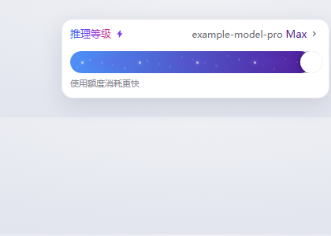
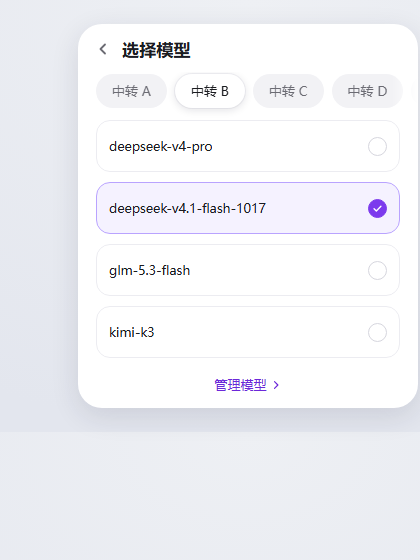

# dsh-effort-dial

DSH 模型菜单里的 **Codex 风格推理等级滑条**。点开输入框旁的模型席，官方那两行下面
铺一条滑条：颜色、能量、星尘数量与速度**全部跟着旋钮位置连续变化**，不是四档开关。

> **来源**：本项目由 [dsh-codex-power-slider](https://github.com/NNNOOOMII/dsh-codex-power-slider)
> 重绘而来，底层 slot / RPC / 投影核对逻辑沿用其设计，界面与交互已全部重写。
> 原项目 MIT，版权归 NNNOOOMII 所有，详见 [LICENSE](./LICENSE)。

## 前置条件

- **DeepSeek Harness 桌面端**（DSH），且用 `desktop` profile；插件在该 profile 的 bundle 栈里加载
- 模型配置里要有 `reasoning.efforts`（见下文「档位是模型给的」），否则滑条不显示
- Node.js ≥ 18（仅跑离线断言时需要）
- 与 `dsh-codex-power-slider` **不要同时启用**（都占 `conversation.input.model` slot）

## 界面



点开模型席之后，只有一行 + 滑条；右边那颗闪电是提示词增强开关（见下文）。

收起态是 `模型名 档位名 ⌄`，档位文字按位置着色（Off 档保持官方灰）。

### 模型入口就在这一行里（点开是二级菜单）

一级只有一行 + 滑条；右边 `模型名 + 档位 + ›` 整块是按钮，点开进**二级菜单**：



选中项：淡紫底 + 紫描边 + 实心勾。

- **厂牌是横向标签页**（选中态浮起 + 右侧渐隐提示可继续滑），官方组挂 `官网` 标记，
  用来区分各中转里的同名模型
- **单列模型卡**：这是实测决定的 —— 双列时每列只有 147px，
  `deepseek-v4-pro` 会被截成 `deepseek-v4-…`，和隔壁 `deepseek-v4.1-…` 分不清
- 进二级会**自动停在当前模型所属的厂牌**页（否则一个勾都没有）
- 点任一模型即切换，并自动滑回一级；`‹` 直接回一级
- 二级里**没有思考深度** —— 那是主界面那条滑条的事

点任一模型即切换。换模型时档位跟着模型走 —— 新模型支持当前档位 id 就保留，
否则退回它的 `defaultEffort`；没有档位的模型不画滑条。

### 四层轨道

| 层 | 行为 |
|---|---|
| 底轨 | 跟随主题 token（`--dsw-alias-border-l1`，缺失回落中性灰） |
| 填充 | `linear-gradient(90deg, #4d93f8, 当前位置色)` —— **左端恒为蓝**，右端越往右越深 |
| 能量 | 紫色星云 + 扫光，宽度与填充相同（**未达到的那段不出现能量条**），强度 = `energyAt` |
| 星尘 | 独立层，整轨横穿，亮度与大小同源（亮的更大） |

### 位置 → 参数

| 位置 | 颜色 | 能量 | 星尘 | 速度 |
|---|---|---|---|---|
| 0 | 蓝 `#4d93f8` | 0 | 0 | 0.35× |
| 1/3 | 蓝（**恒蓝**） | 0 | 0 | 0.35× |
| 2/3 | 紫 `#9333ea` | 0.5 | 11 | 1× |
| 1 | 深紫 `#4c1d95` | 1 | 22 | 2× |

星尘横穿时长 = `STAR_BASE / speed`：满档 1.5s、2/3 是 3s、最低速 8.6s。

### 拖动手感

- **零延迟跟手**：拖动中旋钮的 `left` **没有任何过渡**（旧版挂 `.04s linear`，等于永远慢
  2~3 帧，指针甩快了旋钮就在后面追），并且旋钮位置在 `pointermove` 里**同步**写，
  填充/能量/星尘合到下一帧（`requestAnimationFrame`）再画。
  实测：一步跨 155px 滞后 **0.26px**，20 步高频连发滞后 **0.05px**。
- **档位阻尼（磁吸）**：指针进到刻度 ±20px 内会被"吸"，正中吸力最强，到 20px 归零。
  慢拖时旋钮被钉在刻度上（指针走 5px、旋钮只走 0.6px），要用力才拽得出来；
  快拖时指针一步跨过吸附圈，吸力≈0，直接贴手 —— **手感和跟手不打架**。
  它是纯函数（位置只由当前指针决定、不累加），所以永远不会漂移。
- 被吸住时旋钮：放大 1.13 + 边缘泛紫 + 换成带紫晕的白，说明行跟着实时变。
  （不在轨道里点亮刻度 —— 28px 的旋钮正好把 3px 刻度点整个盖住，盖住的高亮等于没有。）
- 拖动时旋钮后方拖一条**彗尾**，长度跟指针速度，方向自动换边
- 越档瞬间：能量层闪一下 + 该刻度点闪白
- 推满最高档：**冲击波圆环 + 8 颗墨点溅射**，轨道 `brightness(1.22)` 400ms 回落
- **说明行、档位名、彩色流光都跟着拖动实时变**（不等松手）：这些在 `paint()` 里直接写 DOM，
  和填充、旋钮同一帧；只靠 React 渲染的话拖动时不会重渲染，看着像没反应
- **每一档都有一句说明**（滑条下方）：不进行额外思考，响应最快 / 针对简单问题快速作答 /
  针对高难度问题提供更深入的分析 / 面向复杂推理与长链路任务 / 使用额度消耗更快（最高档常驻）
- 模型自己带了 `description` 就用它的；DSH 给每档都带 `name`（Low/Medium/High…），
  以前走"有名字就用自己的描述"那条分支直接拿到空字符串，说明行整行空白 —— 现在按档位 id 回落内置文案
- 松手：沿用拖动中最后显示的档位提交，不用 `round()` 重算（否则边界处「松手抽一下」）；
  落位用 **WAAPI 弹簧曲线** 220ms（`cubic-bezier(.22,1.28,.36,1)`），有一点点回坐感
- `← →` / `↑ ↓` 逐档，`Esc` 关闭

### 「推理等级」是 Max 档专属的彩色动画字

**只有停在 Max / Ultra 档时**这四个字才流光；Off / Low / Medium / High 一律是普通灰字
（用档位 id 判，不用 index —— 3 档模型的顶格叫 `high`，不该白嫖这个效果）。

效果：`background-clip:text` + 一条三色渐变（蓝 → 紫 → 品红）缓慢**往返**漂移（9s），
再叠一层光晕**呼吸**（4s）。深色用亮一档的色（`#38bdf8 / #a78bfa / #fb7185`），
浅色压深（`#2563eb / #7c3aed / #db2777`），否则白底读不出来。

为什么是往返而不是匀速流动：滑条里已经有星尘在飘、能量在扫，标签再匀速跑就成了第三个
"动的东西"，而且匀速渐变字很容易被读成"正在加载"。

`prefers-reduced-motion` 下保留渐变、停掉动效（静止的彩字仍好看，动起来才是负担）。
标签只在弹层打开时渲染，所以收起状态完全不占 GPU。

### 闪电：提示词增强（真写进输入框）

「推理等级」右边那颗闪电是个开关，**点亮才生效，熄灭一个字节都不动草稿**。
它没有方框、没有文字标签、下面也不加说明 —— 开着是紫色，关着是灰色，就这一个信号。

宿主把输入框正文放在 `conversation.input.shell(sessionId)` 上，所以这里不是装样子：

| | 行为 |
|---|---|
| 读 | `shell.state.getSnapshot().draft` |
| 写 | `shell.actions.setDraft(text)`（`phase` 是 submitting/adjudicating 时会被拒，所以先判断） |
| 点亮（草稿已有内容） | 立刻把 `【增强】…` 放在最前面 |
| 点亮（草稿为空） | 待命，不塞任何字；你敲第一个字时补上 |
| 点亮期间 | 盯着草稿：换行了、清空了、被你手动删掉了，只要重新有内容就续上（220ms 防抖），不会出现"灯亮着却没增强" |
| 熄灭 | 只抽掉那一行，你自己的正文一行不动（有来回还原的断言） |
| 发送中 | 不插，等它发完 |

增强的内容是一行中文要求：**先拆解再动手、能并行就并行、主动多轮派子代理分头干活（检索/读码/验证各一路）、自己只做拆解汇总与交叉核对、结论要有独立证据**。
它在输入框里是**可见的普通文字**，你能看见、能改、能删 —— 不搞看不见的暗改。

拿不到输入框（宿主版本不匹配）时按钮变禁用并说明原因，**绝不假装生效**。

### 动画（已固定为「完整」）

右键设置面板已按需求移除，动画固定走完整特效，刻度点固定亮白。
`prefers-reduced-motion` 时全部放缓而不是冻住。

## 安装

把仓库克隆到本地（下面用 `<插件目录>` 指代这个文件夹的**绝对路径**）：

```bash
git clone https://github.com/<你的用户名>/dsh-effort-dial.git
```

**方式一：命令行**

```bash
dsh plugin --profile desktop add link:<插件目录>
```

**方式二：手工**

1. profile `package.json`（默认 `~/.dsh/profiles/desktop/package.json`）的 `dependencies`
   加 `"dsh-effort-dial": "link:<插件目录>"`
2. 同一文件的 `dsh.profile.bundles` 数组里加 `"dsh-effort-dial"`
3. 在 profile 的 `node_modules` 下建一个指向 `<插件目录>` 的链接/联接：
   - Windows（PowerShell，无需管理员）：
     `New-Item -ItemType Junction -Path "<profile目录>\node_modules\dsh-effort-dial" -Target "<插件目录>"`
   - macOS / Linux：`ln -s <插件目录> <profile目录>/node_modules/dsh-effort-dial`
4. **完全退出 DSH 桌面端再重开** —— 客户端启动图只在进程启动时构建，热重启不生效

> 验证顺序：改完先跑 `node test/functions.mjs`，再重开 DSH，点开输入框旁的模型席确认滑条出现。

## 数据

没有任何假数据：

- 读档位：`ctx.sessions.binding(sessionId).session.projections.faceOf('modelSelection')`
- 列模型：`ctx.remote.session.modelCatalog()`
- 写档位 / 换模型：`ctx.remote.session.selectModel({ sessionId, provider, model, reasoningEffort })`

**提交后要核对，不能只看 RPC 返回 ok。** `selectModel` 成功只代表请求被接受，
所以 `commit()` 里会最多等 1.6s 轮询投影，真变成我们请求的值才算成功；没跟上就如实
报错（带上「现在仍是 X」），不谎报。提交占位有三个出口（投影确认 / 失败 / 2.5s 兜底）。

### 档位是模型给的，不是画上去的

滑条档位来自 `model.reasoning.efforts`，没有该字段的模型不画滑条，只显示
「该模型没有可调的推理档位」。**想要 Max 档，模型配置里必须有 `max`**：

```yaml
# profile 的 cordis.patch.yml → llm-pi-ai → providers → <provider> → models[] → reasoningEfforts
reasoningEfforts:
  low: low
  medium: medium
  high: high
  max: max        # ← 没这行，滑条最右就是 high
```

部分中转实测认 `max`（`reasoning_effort:"max"` 返回 200 且
`completion_thinking_tokens` 明显上升）；若所用模型不认，滑条最右就停在 `high`。

## 工程约束（改之前必读 PITFALLS）

- `lib/client.js` 是**经典脚本**，不能 `import/export`，全程单文件
- 拖动期间**不触发 React 重渲染**：`paint()` 直接写 style，22 颗星尘每帧重渲染会掉帧，
  也会因为重渲染把跟手的旋钮拽回格位
- 星尘改时长时用**负 `animation-delay` 补偿进度**，相位不跳
- 相位用确定性伪随机铺开，高度是确定性随机排列（相邻相位至少差 28% 轨道高）

## 与 dsh-codex-power-slider 的关系

本项目是它的重绘分叉（MIT，版权归原作者，见 [LICENSE](./LICENSE)）。
两者都占 `conversation.input.model`、priority `-1`，**不要同时启用**，否则同一格会渲染两条。

## 测试

```
node test/functions.mjs      # 143 项离线断言（几何/配色/粒子/相位相关/磁吸/增强提示词/文案兜底）
```

浏览器里看真渲染：打开 `test/harness.html`（走 CDN 加载 React，自带假宿主 + 一个能读写的假输入框，闪电开关可以真点）。
假宿主带两个开关，专门造失败场景：

- `window.__failNext = true` → 下一次 `selectModel` 返回 `ok:false`（验报错与回弹）
- `window.__delayMs = 900` → RPC 成功但投影 900ms 后才更新（验「不等投影就报错」的假阳性）

### 真机实测（2026-11-27，DSH desktop 0.2.0-rc.2）

用 CDP 连渲染进程跑的一轮，不是看截图猜的：

| 动作 | 结果 |
|---|---|
| 点「模型」行 | 列表弹出，12 个分组、当前项打勾、其余标 `N 档` |
| 点 `deepseek-v4-pro` | 会话 `pending.model` 变 `deepseek-v4-pro`，收起态跟着变 |
| 拖到最右 | 收起态 `Max`、档位文字 `Max`、22 颗星尘、能量 1.0 |
| 读会话真值 | `modelSelection.pending.reasoningEffort = "max"` ✅ |
| 切到 `kimi-k3.1-pro`（无档位） | 不画滑条，提示「该模型没有可调的推理档位」 |
| 宿主拒绝 | 显示宿主返回的原因，档位回弹到真实值 |
| 浅/深两套主题 | 渐变无接缝、旋钮有暗边、星尘有暗晕 |

### 跟手与阻尼实测（v0.4.0，同样走 CDP）

真机滑条宽 286.4px / 内轨 258.4px / 5 档：

| 动作 | 结果 |
|---|---|
| 一步 0.06 → 0.66（跨 155px） | 旋钮落 0.6590，**滞后 0.26px** |
| 20 步 / 6ms 连发冲到 0.16 | **滞后 0.05px** |
| 指针停在刻度旁 4px | 旋钮只离刻度 **0.39px**，`is-dent` 生效、旋钮泛紫 |
| 指针离开刻度 24px | 旋钮离刻度 23.77px（完全跟手，吸附圈外不干扰） |
| 松手 | WAAPI 插值 0.2834 → 0.2573(25ms) → 0.2489(85ms，轻微回坐) → 0.2496 |
| 拖到最右松手 | 会话 `pending.reasoningEffort = "max"` ✅ |

### 闪电开关实测（v0.5.0，真机）

| 动作 | 结果 |
|---|---|
| 弹层里点闪电 | `disabled=false`（说明 `conversation.input.shell()` 在真宿主里拿到了） |
| 草稿为空时点亮 | 不塞字（输入框保持干净），开始打字时才补 |
| **关掉弹层后**再打字 | 前缀照样补上（`draft` 变成 `【增强】…\n测试文本`）✅ |
| 熄灭 | 只抽掉增强那一行，`draft` 严格还原成用户原文 |
| 提交中（phase=submitting） | 不插入 |

注意：DSH 的模型切换是**下一轮消息生效**（写进 `modelSelection.pending`），
官方菜单也是这个语义，不是插件没生效。

## License

MIT — 本项目由 [dsh-codex-power-slider](https://github.com/NNNOOOMII/dsh-codex-power-slider)
（MIT，© NNNOOOMII）重绘，底层逻辑沿用其设计，原版权声明一并保留在 [LICENSE](./LICENSE)。
